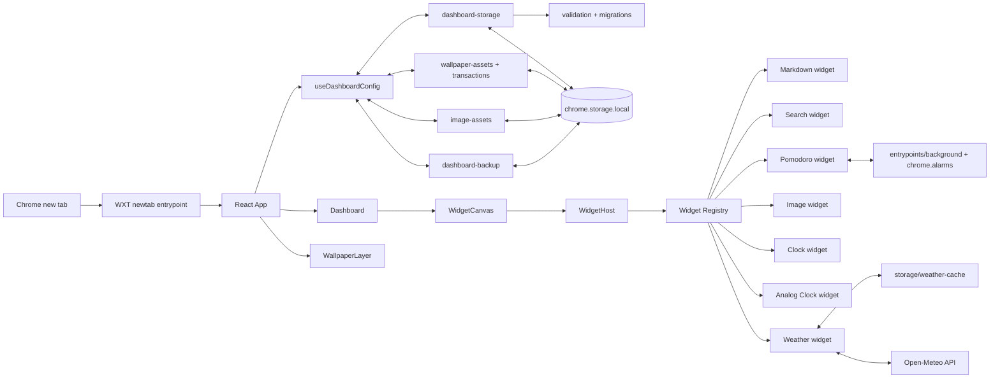

# Architecture

## System Flow



`entrypoints/newtab/main.tsx` mounts `App` and loads global/Tailwind and grid
styles. `App` is the composition root: it resolves appearance, applies the theme
to the document, surfaces persistence errors, and connects state operations to
`Dashboard`.

## Запуск без расширения

Для запуска без установки расширения добавлена отдельная Vite-точка входа
`web/index.html`. Она монтирует тот же `entrypoints/newtab/main.tsx`.
Только веб-конфигурация заменяет `#imports` и `wxt/browser` /
`@wxt-dev/browser` адаптерами из `web/`. WXT-сборка и её manifest не меняются.
Сам WXT Storage переиспользуется; `web/storage.ts` реализует необходимые
операции `storage.local/session` через транзакции IndexedDB и onChanged через
BroadcastChannel. Ошибки записи не подменяются успешным сохранением в памяти.
Сессия удерживается общим Web Lock на время жизни окон; следующий запуск
очищает сессионное хранилище, сохраняя локальное.

Адаптер браузера предоставляет только используемые веб-возможности: пути
статических ресурсов и открытие HTTP/HTTPS-ссылок. Фоновые API не эмулируются.
Приватный Chrome favicon заменяется существующим fallback, а локальные ссылки
копируются. Репозитории, схема v9, миграции и обработка конфликтов общие.
Tailwind явно сканирует корень репозитория независимо от Vite root.

`scripts/dev-app.mjs` запускает Vite и отдельный Chrome/Chromium-профиль
в режиме `--app`. Docker собирает веб-target и раздаёт его nginx; пользовательские
данные остаются в IndexedDB браузера. Детали и ограничения — в DEVELOPMENT.md.

## Module Boundaries

| Layer                   | Responsibility                                                               |
| ----------------------- | ---------------------------------------------------------------------------- |
| `components/dashboard/` | Ephemeral edit/dialog state, grid interaction, widget hosting                |
| `components/ui/`        | Domain-free accessible primitives and shared favicon wrapper                 |
| `widgets/`              | Typed definitions, factories, renderer/editor behavior, domain helpers       |
| `storage/`              | Persistent schema boundary, defaults, validation, migrations, WXT repository |
| `hooks/`                | React state, debouncing, write ordering, lifecycle flushes                   |

UI does not access Chrome storage directly. Storage does not depend on React.
Renderer-derived state is not persisted.

## Configuration and Registry

`storage/schema.ts` defines `DashboardConfig` version 9 and maps widget type
literals to concrete configs through `WidgetConfigMap`. Each config contains an
ID, type, optional title, and `{x,y,w,h}` layout; Markdown adds `content`,
`template` (`'blank' | 'tasks' | 'daily-plan' | 'links' | 'draft'`),
`quickAddEnabled`, `hideCompletedTasks`, and optional `showWebsiteSetButton`, Search
adds `engine`, Pomodoro adds duration and sound settings, Image adds `source`,
`objectPosition`, and optional `altText`, Clock adds `timeFormat`, `showTime`,
`showSeconds`, `showDate`, `dateFormat`, `showDayOfWeek`, `timezone`,
`showTimezoneName`, and `showTimezoneAbbr`, Analog Clock adds `dialStyle`
(`'minimal' | 'numbers' | 'bauhaus'`), `showSeconds`, `showDate`, `showTimezone`,
and `timezone`, and Weather adds `mode`
(`'visual' | 'compact'`) and `location` (`'unset' | 'city'`). Weather
forecast data is cached in WXT Storage under `local:weather-cache:<id>` and not
persisted to dashboard config or backup.

`widgets/registry.tsx` is the only widget integration point. It dynamically
loads each widget renderer when that widget is mounted and loads its editor only
when editing begins. A definition owns:

- metadata and factory;
- runtime type guard;
- renderer, optional editor and optional read-only reader;
- card/bare chrome and inline/dialog editor presentation;
- title behavior and dialog size;
- per-type layout constraints and resize handles.

`WidgetHost` asks the registry to render/edit a config and shows a safe fallback
for unknown types. Adding a widget type requires updating the config map,
storage validation, registry definition, factory, renderer/editor, and tests.
Increase the schema version only when persisted compatibility requires it.

Рендерер получает необязательный `headerActionsTarget` — DOM-контейнер действий
в заголовке карточки. Виджет может вывести кнопку через React portal, сохраняя
логику и состояние внутри себя; host не разбирает тип или содержимое виджета.

`Reader` и предикат `canRead` задаются типизированным определением
виджета; `renderReader` проверяет конфигурацию перед созданием компонента.
`WidgetHost` показывает независимую от режима редактирования кнопку
разворачивания. Просмотр использует общий нативный `Dialog` на весь viewport
с фиксированной шапкой и закрытием по Escape/кнопке. Закрытие возвращает фокус
на кнопку карточки; содержимое освобождается после перехода закрытия.
Состояние просмотра существует только в памяти и не меняет компоновку.
`data-no-drag` и роль диалога исключают действия внутри просмотра из
обработчиков перемещения и выделения нижележащей сетки.

Режим подключён для Markdown и изображений. Markdown использует тот же
санитайзер и renderer без обработчика изменения содержимого, поэтому задачи
недоступны для изменения, а ссылки и копирование кода сохраняются.
Изображение использует общий renderer с временным `reading`-режимом:
`contain`, центрирование и отсутствие zoom не изменяют исходную конфигурацию.
У пустого изображения кнопка скрыта. Таймеры и погодные эффекты в просмотре
не дублируются.

## Command Palette

`components/dashboard/command-catalog.ts` derives typed commands from the
current in-memory config, widget registry, and theme registry. Search performs
case-insensitive substring matching; neither the catalog nor query is stored.
Markdown notes from every workspace are indexed as plain text by
`widgets/markdown/search-text.ts`; matching results include a bounded excerpt.
Note results appear only for a nonempty query. Selecting one switches the
workspace through the existing state hook, then scrolls to and focuses the
mounted card after the workspace render.
`CommandPalette` owns only dialog, query, selection, and theme-list state. It
uses the shared `Dialog` launcher variant: top-centered 480 px search field,
results below it, subtle backdrop, screen-reader-only title, and a narrow-
viewport offset below the toolbar. Closed search remains visually absent.
`DashboardControls` executes commands through existing Dashboard callbacks.
Widget focus uses the rendered card's `data-widget-id` and temporary focus.
`widgets/markdown/extract-links.ts` parses saved Markdown with `remark-parse`
and `remark-gfm`, then validates candidate URLs with the same `normalizeLinkUrl`
rule as the renderer (supporting HTTP/HTTPS and local `file://` URIs). No Chrome bookmarks access or permission is used.
`download-backup.ts` shares the Blob download between the backup dialog and
direct export command; both call the same queued backup export hook.

## State and Persistence

`storage/dashboard-storage.ts` owns the WXT item `local:dashboard-config`.
Loading reads `unknown`, calls `migrateDashboardConfig`, and writes back any
migrated/normalized object. Saving validates through the same boundary.

Current migration behavior:

- v1 `links` becomes `markdown`, preserving ID, title, content, and layout;
- v1 and v2 appearance data gains `{type: 'none'}` wallpaper state;
- v1, v2, and v3 gain the default `liquidGlass` group when migrated to v5+;
- v4 keeps `liquidGlassEnabled` while migrating it into the v5 group and gains
  standard transparency, blur, and shadow values;
- v5 appearance `theme: ThemeId` migrates to `theme: { type: 'builtin', id: ThemeId }`,
  `backgroundColor` string migrates to `{ type: 'custom', color }` (or `{ type: 'theme' }`
  if matching theme default), and config gains `customThemes: []`;
- retired WIP `google-calendar` widgets are removed from v2 while all supported
  widgets and appearance data are preserved;
- v6 configs migrate to v7 by assigning default `template: 'blank'`,
  `quickAddEnabled: false`, and `hideCompletedTasks: false` to all markdown widgets;
- v7 получает рабочие пространства в v8; v8 → v9 сохраняет все пространства,
  активный ID, темы и ресурсы и добавляет `toolbar: { mode: 'top-right' }`;
- current and legacy SearchWidget layouts are normalized to `h: 1`;
- malformed and unsupported/future versions throw explicit errors.

`useDashboardConfig` keeps state plus a synchronous ref so rapid updates compose
against the latest config. Add/remove, ordinary appearance, and completed layout
changes save immediately.

Поле `appearance.widgetBorderRadius` необязательно: отсутствие означает `12 px`,
допустимы целые значения `0–40`. Это совместимое дополнение схемы v9;
старые конфигурации и резервные копии сохраняют прежний вид без миграции.
CSS-переменная `--widget-border-radius` применяется к поверхностям виджетов,
поиску и вложенным оболочкам изображений и погоды.

Ползунки Liquid Glass и скругления обновляют React state для предпросмотра и
сохраняют изменения после завершения ввода мышью или клавиатурой, потери фокуса,
закрытия диалога, `pagehide` или unmount.

Widget/editor changes use a 300 ms debounce. Saves are
queued to prevent an older slow write from overwriting newer state; pending
widget changes flush on editor finish, Escape, `pagehide`, and unmount.

Структурные действия с виджетами записываются в память вкладки как история из
50 шагов. Для drag/resize хранятся только координаты, поэтому Undo не откатывает
позднейшие правки содержимого. Для добавления и удаления сохраняются
конфигурации и порядок виджетов; новый шаг очищает Redo. Импорт и принятие
внешнего состояния очищают историю.

Геометрия `Shift+стрелка` вычисляется в `dashboard-layout.ts`: группа движется
до ближайшего препятствия или края сетки. Для движения вниз `Dashboard`
передаёт нижний ряд, полностью видимый в текущем окне; обычные стрелки
по-прежнему сдвигают группу на одну клетку.

Записи конфигурации проходят через общий Web Lock и перед записью сверяют
`local:dashboard-config` с последней принятой версией. WXT watcher обновляет
вкладки без локальных правок. При конфликте локальная запись приостанавливается
до выбора версии в диалоге. Временные ссылки на изображения для Undo и локальных
несохранённых изменений хранятся
через WXT `storage.session` по ID вкладки; очистка учитывает ссылки всех
открытых вкладок, а background удаляет ссылку при закрытии вкладки.

Backup export and import use the same serialized operation queue. Export first
flushes pending widget and appearance changes, then snapshots the current
validated config and referenced local wallpaper. Import validates and prepares
the complete backup before it joins the queue, so older queued saves always
finish before the replacement commit.

## Backup Format and Restore

`storage/dashboard-backup.ts` owns the JSON wire format independently of the
persisted dashboard schema. Текущий формат v3 содержит маркер
`chrome-start-page-backup`, `formatVersion: 3`, время экспорта, `DashboardConfig`,
массивы `localWallpapers` и `localImages` для всех пространств. Форматы v1/v2
с единственными `localWallpaper` остаются совместимыми. Вложенная конфигурация
всегда проходит обычную миграцию; глобальный `toolbar` переносится внутри неё
без повышения версии оболочки backup.

Local wallpaper and image data are decoded, checked against config asset IDs, and
browser-validated before any write. Import assigns fresh UUIDs to all local
assets, saves the new assets before the replacement config, rolls them back if
the config write fails, and removes previous assets only after commit. Non-local
imports save the replacement config before removing any previous local assets.
A cleanup failure is reported as a warning without rolling back an already valid
import. HTTPS wallpaper and remote images remain URLs and are revalidated before
commit.

The dashboard backup dialog performs file selection and Blob download but never
accesses extension storage directly. Browser-native Blob/object URLs avoid a
`downloads` permission. Closing the dialog aborts validation; once the queued
storage transaction begins it is allowed to finish atomically.

## Wallpaper Pipeline

`AppearanceConfig.wallpaper` is a discriminated union: no wallpaper, an HTTPS
URL, or a local asset UUID, each optionally supporting an `enabled` flag.
Disabled wallpapers retain their configuration and local assets without
rendering the background layer, allowing seamless toggling via the appearance
dialog or command palette. Remote URLs are validated by browser image loading
without broad host permissions or an extension `fetch`. Local files support
PNG, JPEG, WebP, GIF, AVIF, and SVG; signatures/content and browser decoding are
checked before the persisted config changes.

Local bytes are stored separately through `storage/wallpaper-assets.ts` under
`local:dashboard-wallpaper:<uuid>`. Files at or below 6 MiB remain byte-for-byte
unchanged. Larger files are gzip-compressed only when the lossless result fits
within 6 MiB; otherwise the original is retained under `unlimitedStorage`.
`storage/wallpaper-transactions.ts` saves the new asset and config before
removing the old asset, rolls a new asset back on config failure, and cleans up
orphaned wallpaper keys on startup.

`useWallpaperImage` decodes and revalidates local assets before creating a Blob
URL, revoking it on replacement/unmount. `WallpaperLayer` is a decorative fixed
layer behind the dashboard and uses centered `object-cover`, so it fills the
viewport and crops overflow. Failed validation leaves the previous wallpaper
intact and is surfaced in the appearance dialog.

## Dashboard Layout

`dashboard-layout.ts` converts domain layouts to/from `react-grid-layout` and
applies registry constraints. The grid has 12 columns, 48 px rows, and 16 px
gaps. Markdown defaults to `4×3` with minimum `3×3`; Search defaults to `6×1`,
minimum width 3, fixed height 1, and horizontal resize from either side.

В режиме редактирования размер виджетов можно менять за любую сторону или угол.
Боковые зоны захвата проходят вдоль краёв; у поиска доступны только левый и правый
края, а высота остаётся равной одной строке.

Dragging/resizing is edit-mode-only. The no-compaction strategy blocks
collisions but preserves explicit coordinates. Dragging is intentionally
unbounded vertically so empty rows below the current content remain reachable
and the canvas can grow. Interactive controls are excluded from the drag
gesture. At viewport widths below 960 px, the canvas scrolls horizontally
instead of transforming persisted layouts.

В режиме редактирования виджеты выделяются по одному или группой. Для
группового drag `WidgetCanvas` вычисляет единый сдвиг и показывает его локально,
проверяя всю группу на выход за 12 колонок и пересечения; запись происходит
после отпускания. Одиночный drag/resize остаётся в `react-grid-layout`.
Клавиатурный сдвиг использует ту же проверку геометрии.

Буфер виджетов — отдельный версионированный JSON с конфигурациями и локальными
изображениями, без состояния таймеров и кэшей. Входные данные проверяются через
текущую схему и декодирование изображений. Вставка назначает новые UUID и
сохраняет относительное расположение; локальные ресурсы записываются до
конфигурации и удаляются при ошибке транзакции.

## Markdown Widget

`MarkdownWidget.content` is the sole source of truth. `MarkdownRenderer` uses:

```text
Markdown -> remark-gfm -> remark-directive -> remarkTextSizeDirectivePlugin -> remarkTaskFilterPlugin -> rehype-raw -> rehype-sanitize -> React components
```

The pipeline supports:

- **5 note templates** (`blank`, `tasks`, `daily-plan`, `links`, `draft`) selected via a unified modal dialog (`SelectTemplateDialog`) during widget creation from both `AddWidgetDialog` and `CommandPalette`;
- **Quick Add input** positioned at the bottom of the card with template-specific formatting (checkboxes for `tasks`/`daily-plan`, link normalization for `links`, escaped text for `blank`/`draft`);
- **Task filtering** (`hideCompletedTasks`), which hides completed items while preserving parent items if they contain incomplete subtasks, and shows an empty state («Все задачи выполнены») when all tasks are complete;
- **Single-line text size directives** (`:large[текст]` for 18px and `:xlarge[текст]` for 22px), validated to exclude multiline text, code blocks, and links, sanitized via allowed `data-size` on `span`.

The sanitizer admits the required structural/formatting subset (including
tables, `details`, `summary`, `mark`, `kbd`, `sub`, `sup`, `ins`, and directive `span` with `data-size`) and removes
executable/embedded/form content, event attributes, arbitrary class/style data,
and unsafe URLs. React rendering does not use `dangerouslySetInnerHTML`.

Component overrides enforce HTTP/HTTPS links and absolute HTTPS images again.
Links stay in the current tab and use Chrome's local `_favicon` via
`SiteFavicon`; images are lazy, async-decoded, bounded, and `no-referrer`.
Fenced code is unhighlighted, horizontally scrollable, and copyable.

Task-list interaction uses the list item's AST source offset to toggle the exact
`[ ]`/`[x]` marker in source text. The fullscreen editor owns ephemeral
split state (50/50 on each open, keyboard/pointer range 30–70), provides behavior
settings (template picker, quick add switch, hide completed switch, text size dropdown),
and sends title and content changes through the normal debounced persistence path.

Редактор использует одну общую панель инструментов: «Размер текста» слева,
«Настройки» и «Готово» справа. Заголовок редактируется отдельным полем без
постоянной рамки и фона над Markdown-текстом, на одном уровне с названием в
предпросмотре. У обеих колонок одинаковые отступы; служебной полосы «Предпросмотр»
нет. Заголовок не входит в Markdown-текст.
Пустой или пробельный заголовок остаётся пустым в карточке, предпросмотре и режиме
чтения; название типа используется только для доступных имён элементов управления.

Шаблон и переключатели поведения скрыты под кнопкой «Настройки». Выпадающие
блоки настроек и размера текста закрываются по Escape, внешнему клику или выходу
фокуса; Escape возвращает фокус к кнопке и оставляет редактор открытым.
Шаблон выбирается общим компонентом `Select`; список раскрывается внутри блока
настроек, поддерживает клавиатуру и закрывается первым нажатием Escape.
Переключатели поведения — кнопки с `role="switch"`: вся строка обрабатывает клик,
а доступное состояние и положение бегунка напрямую зависят от конфигурации виджета.

Рабочий набор сайтов формируется из HTTP/HTTPS-ссылок одной Markdown-заметки
без отдельной сохраняемой модели. Общий разборщик `extract-links.ts`
учитывает обычные, автоматические, HTML- и ссылочные Markdown-ссылки.
`website-set.ts` нормализует и удаляет повторяющиеся адреса, а платформенная
функция открывает их последовательно через `tabs.create({ active: false })`.
Текущая вкладка остаётся активной; новые разрешения Chrome не нужны.
Компактная кнопка запуска в заголовке карточки показывает иконку и число сайтов;
полное действие «Начать работу» доступно в подсказке и accessible name.
Кнопка по умолчанию скрыта; редактор заметки сохраняет её видимость в
необязательном boolean-поле `showWebsiteSetButton`. Отсутствие поля означает
`false`, поэтому существующие конфигурации и резервные копии совместимы без
изменения версии схемы. При включённой настройке кнопка видна только при наличии сайтов.
Кнопка блокируется до завершения запуска, результат остаётся под содержимым.
При частичной ошибке повтор открывает только
неудавшиеся адреса. Состояние запуска и повторов существует только в памяти
виджета и сбрасывается при изменении Markdown.

## Search Widget

Search is intentionally a bare form with no visible card or title. Engine
definitions in `widgets/search/engines.ts` contain fixed HTTPS action, query
parameter (`q`, or Yandex `text`), label, and bundled icon path. The native GET
form has no target, so explicit submission replaces the current new tab. Empty
queries are prevented; trimmed query text remains form-only and is never stored.

The icon URL is resolved with `browser.runtime.getURL`. Local vector marks from
CoreUI Brands and DuckDuckGo's press kit render at optically balanced 24–28 px
sizes in decorative, theme-independent glass badges on the left. A theme-colored
outline magnifier replaces a missing asset. The submit button on the right uses
the shared outline magnifier. A matching outline close button clears typed text
and restores focus; Chrome's native search cancel control is hidden. One search
surface contains both controls and shows focus on the whole row; its glass effect
follows the existing appearance settings with a minimum tint for text contrast
over arbitrary wallpapers. Chrome `_favicon` is not used for search brands and
remains enabled only for user Markdown links.

## Liquid Glass

Статический Liquid Glass применяется к карточкам Markdown, часов, Pomodoro,
компактной погоды и пустого изображения, поверхности Search и верхней панели
управления в обоих состояниях.
Погодная сцена и загруженное изображение получают только стеклянную кромку и
тень: их содержимое не перекрывает дополнительная подложка.
Состояние и параметры хранятся в `appearance.liquidGlass`: переключатель,
прозрачность `0–100%`, размытие `0–40 px` и тень `0–100%`. Стандартные значения
`40% / 18 px / 50%` можно восстановить отдельной кнопкой без изменения
переключателя. Настройки находятся в блоке «Карточки» раздела «Оформление»
боковой панели «Настройки». Ползунки доступны через «Настроить эффект» при
включённом стекле; скругление доступно всегда.

`App` добавляет корневой класс `liquid-glass-enabled` и преобразует числа в CSS
custom properties. Theme-aware формулы используют их для ровной полупрозрачной
подложки, blur и короткой внешней тени. Отражение ограничено внутренней кромкой;
градиент на всей площади карточки не используется. Виджеты используют
семантические классы поверхностей без передачи визуальных параметров через
всё дерево Dashboard. Селекторы `:has(.weather-visual)` и
`:has(.widget-image-media)` исключают подложку поверх визуальных сцен.

При выключении карточки и панель управления возвращаются к обычному виду,
а Search — к прежнему bare-виду без внешней капсулы. Панель и карточки
используют одинаковую плотность стеклянной подложки. Стили учитывают все темы;
при отсутствии `backdrop-filter` полупрозрачный фон, рамка и тень остаются
доступным fallback. Диалоги эффект не используют. Новые
зависимости и разрешения расширения не требуются.

## Pomodoro Widget

Pomodoro is a card widget (`3×5`, min `3×4`) supporting customizable focus and
break intervals (work, short break, long break) and cycle-based progression.
While configuration (durations, long break interval, sound toggle) is part of
`DashboardConfig`, dynamic timer runtime state (`status`, `phase`,
`targetEndTime`, `remainingSeconds`, `cycleCount`, `completedToday`,
`lastResetDate`) is isolated in WXT Storage under `local:pomodoro-state:<id>`.

This runtime separation ensures tabs synchronize in real-time via storage
events without triggering dashboard saves or conflicting with the serialized
save queue. A background service worker (`entrypoints/background.ts`) listens
for `chrome.alarms`, fires system notifications (`chrome.notifications`) upon
interval completion even when start page tabs are closed, advances the
timer phase, and plays audio via an offscreen document (`entrypoints/offscreen.html`).
Active tabs additionally play a local Web Audio chime if open.

## Theme System and Design Tokens

The theme architecture lives in `themes/` and decouples color palettes and
visual tokens from widget logic and components:

- `themes/types.ts` defines `BuiltinThemeId` (14 themes: `system`, `light`, `dark`,
  `graphite-mint`,
  `tokyo-night`, `rainy-tokyo`, `cozy-lofi-night`, `catppuccin-mocha`,
  `catppuccin-latte`, `paper-sage`, `apricot-noon`, `nord`, `synthwave-84`,
  `solarized-dark`), `ThemeRef` (`builtin` or `custom`), `CustomTheme` with 28
  semantic color keys, `ThemeTokens`, `ThemeDefinition`, and `ThemePreviewColors`.
- `themes/palettes.ts` provides semantic token definitions for all 13 concrete
  builtin palettes; `system` resolves to the existing light or dark preset.
- `themes/color-utils.ts` contains color helpers: hex validation/normalization,
  relative luminance, WCAG contrast calculation, and linear RGB blending.
- `themes/color-derivation.ts` deterministically derives 22 secondary colors from
  6 primary colors (`canvasBg`, `surfaceBg`, `textPrimary`, `textSecondary`, `accent`,
  `accentText`) and performs WCAG contrast checks.
- `themes/registry.ts` exposes `THEMES: readonly ThemeDefinition[]`,
  `getThemeDefinition(id)`, `resolveTheme(themeRef, systemDarkMode, customThemes)`,
  and `applyThemeVariables` for injecting custom theme CSS variables into the DOM.
- `entrypoints/newtab/themes.css` declares scoped CSS variables
  (`--theme-canvas-bg`, `--theme-surface-bg`, `--theme-accent`, etc.) via
  `:root, [data-theme="..."]` selectors for built-in themes.
- Custom themes apply their full token set via inline style `--theme-*` variables
  in `App.tsx` and in `ThemePreview.tsx`.
- `entrypoints/newtab/style.css` defines the Tailwind CSS 4 `@theme` block
  mapping semantic utility classes (`bg-theme-surface`, `text-theme-text-primary`,
  `border-theme-border`, `bg-theme-accent`) to these custom properties.
- `AppearanceSettings.tsx` displays built-in themes alongside custom user themes with
  cards for creating, editing, duplicating, and deleting custom themes.
- `CustomThemeEditorDialog.tsx` provides full-screen editing with live auto-derivation,
  manual overrides, WCAG contrast alerts, a passive `ThemePreview` thumbnail, and
  full-screen preview of the entire dashboard.

## Weather Widget and Open-Meteo Integration

Weather is a card widget (`5×5`, min `3×3`) supporting visual and compact
modes. It integrates with [Open-Meteo](https://open-meteo.com/) for forecast and
geocoding without API keys:

- Location is configured by searching for a city (`type: 'city'`).
- Forecast requests use `host_permissions` for `https://api.open-meteo.com/*`,
  while city searches use `https://geocoding-api.open-meteo.com/*`.
  Endpoints are declared statically in the manifest.
- Forecast data is cached in WXT Storage under `local:weather-cache:<id>` with a
  freshness window of 30 minutes and a failure retry cooldown of 5 minutes.
  Cached entries are isolated per widget instance, excluded from backups, and
  automatically purged when widgets are removed or backups are restored.
- In visual mode, `weather-scene.ts` derives scene intensity, light, clouds, and
  wind drift from the existing forecast; `WeatherVisualEffects` renders local
  SVG/CSS layers behind readable text zones. Rain combines WMO codes with
  measured rain and showers, and motion respects `prefers-reduced-motion`.
  Compact mode keeps the structured metrics without the scene.
- `WidgetPresentation.cardInset` задаёт общий отступ карточки. Для погоды
  используется `none`: визуальная сцена занимает всю поверхность до скруглённого
  края, а компактный режим и служебные состояния задают собственные отступы.
  `WidgetHost` применяет настройку реестра без отдельной ветки для погоды.
- Визуальный режим располагает город и обновление сверху, температуру и четыре
  показателя снизу. Показатели занимают одну строку на широкой карточке и сетку
  2×2 на узкой. Прогнозы появляются поверх той же сцены при достаточной высоте.

## Extension Boundary

`wxt.config.ts` is the manifest source. Permissions are `storage`,
`unlimitedStorage`, `favicon`, `alarms`, `notifications`, `offscreen`, and `contextMenus`.
Host permissions include `https://api.open-meteo.com/*`,
`https://geocoding-api.open-meteo.com/*`, and `file:///*`. Static assets in `public/` are
bundled, and generated `.wxt/` and `.output/` directories are never source files.

## Сохранение материалов из браузера

`capture/context-menus.ts` регистрирует меню страниц, ссылок и выделенного
текста в service worker. Подменю отражает пространства и Markdown-заметки,
содержит создание новой заметки и обновляется после изменения названий или
состава. Записи одного текста не пересоздают меню. После перезапуска worker
меню строится заново; операции обновления выполняются последовательно.

`widgets/markdown/browser-capture.ts` преобразует выделение в Markdown-цитату
с источником, а страницу или ссылку — в пункт списка. Разметка выделенного
текста экранируется, адреса проверяются существующим валидатором.
`storage/markdown-capture.ts` читает последнюю конфигурацию внутри общего
Web Lock и сохраняет дополненную заметку через репозиторий. Новая карточка
размещается ниже существующих; активное пространство не переключается.
Удалённая цель и ошибки записи показываются уведомлением, успешное сохранение
подтверждается только после завершения записи. Открытые вкладки получают
обновление через существующий WXT watcher и сохраняют обычную обработку конфликтов.

Разрешение `contextMenus` нужно только для явного действия пользователя.
Расширение не сканирует страницы и не получает новых разрешений на сайты,
историю, закладки или чтение всех вкладок.

## Панель управления

Схема v9 хранит глобальный `toolbar: ToolbarConfig` в корне `DashboardConfig`:
`top-right`, `left-fixed` или `left-collapsible`. Настройка не принадлежит
оформлению пространства. `updateToolbar` использует общую очередь немедленных
записей и объединяет изменения с ожидающими правками виджетов и стекла.

`DashboardControls` владеет действиями и диалогами. `DashboardToolbar` отвечает
за оболочку, геометрию и анимацию; `useDashboardToolbar` — за временное раскрытие,
фокус и клик снаружи. Одна копия кнопок используется во всех режимах.
`configEpoch` сбрасывает раскрытие при импорте или принятии внешней конфигурации;
он отделён от `historyEpoch`, который меняется также при переключении пространства.

Левая панель имеет ширину 56 px и отступ 8 px. Высота ограничена viewport;
список действий прокручивается отдельно от кнопки сворачивания. CSS `:has()`
связывает видимость панели с `--toolbar-canvas-shift`: 88 px для открытой или
постоянно видимой панели, иначе 0. Боковые padding полотна одинаковы — по 24 px.
При скрытой панели дополнительных отступов нет; при открытой зазор до карточек — 48 px.
Ширина `.dashboard-canvas-grid` сразу уменьшается на сдвиг; `useContainerWidth`
измеряет итоговую ширину обычным способом, без покадрового пересчёта React-сетки.
Полотно и панель перемещаются через transform за 260 мс с одной кривой
`cubic-bezier(0.22, 1, 0.36, 1)`; `prefers-reduced-motion` отключает сдвиг.
Хранилище и координаты layout не меняются. Минимальная ширина полотна 960 px и горизонтальная
прокрутка сохраняются. Верхний отступ сетки — 24 px вместо 80 px.
`WidgetCanvas` передаёт временное состояние drag/resize для отключения зоны раскрытия.

Обёртка `.dashboard-canvas-viewport` ограничивает горизонтальное переполнение через `overflow-x: clip`
с `overflow-clip-margin: 1.5rem`, соответствующим боковым отступам области.
Это оставляет место теням, но не даёт анимируемым карточкам расширять scroll area
при пересчёте ширины. Минимальная ширина обёртки учитывает 960 px полотна и сдвиг;
на узком экране она по-прежнему прокручивается снаружи;
вертикальное размещение и перемещение не ограничены.

Стрелка раскрытия появляется при hover левой полосы или фокусе через Tab.
Полоса шириной 24 px занимает высоту viewport за вычетом 16 px с каждой стороны.
Внешний `click`
закрывает панель после активации цели; закрытие по `pointerdown` сдвинуло бы
виджеты до отпускания мыши и могло бы отменить или перенаправить клик.

Компактный `WorkspaceSelector` открывает popup справа через portal внутри
`.dashboard-root`, сохраняя переменные темы и стекло. Позиция учитывает viewport,
resize и прокрутку. Обработчики внешнего клика учитывают popup как часть панели.
Скрытая панель использует `inert` и `aria-hidden`; стрелка доступна через Tab.
`Dialog.returnFocusFallback` — необязательная функция получения доступной цели,
если прежний элемент удалён или оказался внутри `inert` после смены режима.

## Доступность и переходы интерфейса

Полноэкранные редакторы Markdown и собственных тем используют общий нативный
`Dialog`. Редактор темы загружается через `React.lazy` только по запросу вместе
с тяжёлым предпросмотром Markdown. При полноэкранном просмотре редактор закрыт,
но остаётся смонтированным: черновик сохраняется до возвращения. При окончательном
закрытии `onExited` освобождает редактор, возвращает окно оформления и фокус
к кнопке, открывшей редактор. Оболочка использует активные semantic tokens;
редактируемая палитра ограничена предпросмотром.

`Disclosure` хранит поля смонтированными при сворачивании, исключает их из
доступного дерева и Tab-порядка через `aria-hidden` / `inert` и возвращает фокус
к заголовку при программном закрытии. Панель настроек управляет раскрытием
разделов через React; закрытие сбрасывает их состояние. `Popover` удерживает
уходящую поверхность только для короткой анимации, сразу делая её недоступной.
Списки внутри диалогов расположены в потоке прокручиваемого содержимого.
Оболочка диалога и анимируемые разделы используют `overflow: clip`, чтобы
`scrollIntoView` прокручивал тело диалога, сохраняя заголовок на месте.
Закрытый `Dialog` становится `inert` сразу, включая время CSS-перехода выхода.
`Select`, выбор часового пояса и поиск города используют `aria-activedescendant`;
Escape сначала закрывает список, затем диалог.

Motion используется только в этих интерактивных поверхностях через `m`,
`LazyMotion` и асинхронный `domAnimation`. `MotionConfig reducedMotion="user"`
отключает пространственное движение, а `useReducedMotion` отдельно отключает
анимацию высоты. Фичи Motion не запрашиваются до открытия интерактивной
поверхности. CSS обслуживает обычные состояния, нативные диалоги, левую панель
и появление содержимого после смены пространства. Первый показ дашборда не
анимируется; смена пространства не дублирует деревья виджетов. Появление нового
виджета меняет только прозрачность и имеет резервную очистку временного флага;
координатами и transform сетки по-прежнему управляет `react-grid-layout`.

`DashboardControls` хранит один `settingsSection`; `SettingsPanel` владеет единственным
`Dialog` размера `drawer` и видимыми вкладками в фиксированной области навигации.
Вкладки используют `tablist`/`tab`/`tabpanel`, перемещаемый Tab-фокус и активацию
стрелками и Home/End с пропуском недоступных разделов. Доступное имя содержимого
связано с вкладкой через `aria-labelledby`; отдельного повторного заголовка нет.
`AppearanceSettings`, `InterfaceSettings`, `WorkspaceSettings`, `BackupSettings` и
`ShortcutsHelp` содержат только интерфейс своих разделов. Оформление и резервные
копии загружаются лениво. Переход между разделами сохраняет экземпляр диалога и
исходную точку возврата фокуса, сбрасывает прокрутку и освобождает содержимое
предыдущего раздела. Переход или закрытие сохраняет ожидающий предпросмотр
оформления; unmount отменяет проверку обоев или незавершённый импорт. При возврате
из редактора темы фокус восстанавливается по идентификатору действия, поскольку
содержимое оформления создаётся заново. Ограничения доступа к изменению данных и
резервным копиям действуют также для вкладок панели.

При
активных обоях управляющие кнопки и всплывающие меню получают непрозрачную
подложку темы; подписи карточек усиливаются без изменения палитры и параметров
Liquid Glass. Изображения и погодные сцены остаются без дополнительного слоя.
